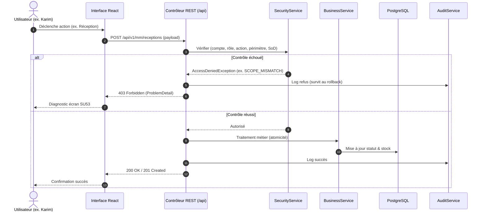

# Spécification de Scénario de Sécurité : [SCN-XX — Titre du scénario]

## 1. Identifiant et Objectif

- **Identifiant :** `SCN-[NUMÉRO]-[CODE_COURT]` (ex. `SCN-01-KARIM-RECEIPT-CORRECTION`)
- **Titre :** [Titre clair et concis]
- **Objectif pédagogique :** [Ce que le consultant junior doit observer, diagnostiquer et corriger]
- **Module(s) concerné(s) :** [MM / FI / SD / CO / Security / Governance]

---

## 2. Contexte Métier Bref

- **Société :** `AD01`
- **Périmètre organisationnel :** [`Casablanca` / `Rabat` / Centre de coûts]
- **Document cible :** [Type et référence du document, ex. Commande PO-2026-0001]
- **Opération métier :** [Ex. Réception de marchandises en stock]

---

## 3. État Initial

### Acteurs et Comptes
| Acteur | Compte (`SU01`) | Statut | Rôle(s) attribué(s) initialement | Périmètre autorisé |
|---|---|---|---|---|
| [Nom] | `[username]` | Actif | `ROLE_[NOM]` | `[SITE/SOCIÉTÉ]` |

### Documents préexistants
| Document | Numéro | Statut initial | Périmètre réel | Auteur |
|---|---|---|---|---|
| [Type] | `[REF]` | [Ex. APPROVED] | [Ex. Casablanca] | [Auteur initial] |

---

## 4. Évaluation du Contrôle d'Accès et SoD

1. **Compte & Session :** Compte doit être actif et session valide.
2. **Attribution :** Rôle attribué avec date de validité couvrant l'instant présent.
3. **Action requise :** `[ACTION_CODE]` (ex. `MM_PO_RECEIVE`).
4. **Périmètre strict :** Doit correspondre à `document.site == assignment.site`.
5. **Règle SoD ou contextuelle :** [Ex. Pas d'auto-approbation / Pas de cumul facture + paiement].
6. **Condition métier :** [Ex. PO doit être au statut APPROVED].

---

## 5. Workflow de Gouvernance et Remédiation

1. **Détection du refus :** L'utilisateur tente l'opération, reçoit un `403` et consulte la simulation `SU53`.
2. **Demande d'accès :** Création d'une demande avec justification, rôle ciblé et périmètre minimal requis.
3. **Analyse d'impact & SoD :** Vérification automatique des conflits avec les rôles existants.
4. **Décision d'approbation :** Validation ou rejet par le Responsable Security.
5. **Application :** Attribution mise à jour avec dates de validité définies.

---

## 6. Diagramme de Séquence (Mermaid)

---

## 7. Matrice des Cas de Test et Preuves d'Audit

| Code | Cas de test | Données de test | Résultat HTTP | Preuve d'audit attendue |
|---|---|---|---|---|
| TC-01 | Cas nominal autorisé | [Compte autorisé, bon site] | `200 OK` | `result=SUCCESS`, action persistée |
| TC-02 | Droit / Action absent | [Compte sans le rôle] | `403 Forbidden` | `result=DENIED`, `MISSING_PERMISSION` |
| TC-03 | Périmètre erroné | [Rôle Casablanca sur doc Rabat] | `403 Forbidden` | `result=DENIED`, `SCOPE_MISMATCH` |
| TC-04 | Document non prêt | [Doc en statut DRAFT] | `422 Unprocessable` | Échec validation métier |
| TC-05 | Conflit SoD / Auto-approbation | [Auteur tente approbation] | `403 Forbidden` | `result=DENIED`, `SOD_VIOLATION` |
| TC-06 | Accès temporaire expiré | [Clock avancée après validTo] | `403 Forbidden` | `result=DENIED`, `ASSIGNMENT_EXPIRED` |
| TC-07 | Compte désactivé / départ | [Compte locked] | `401 / 403` | `result=DENIED`, `ACCOUNT_DISABLED` |
| TC-08 | Appel direct API | [CURL / Test sans UI] | Rejet identique | Audit identique au TC-02/03 |

---

## 8. Procédure de Reset du Scénario (Profil Lab)

- **Endpoint de reset :** `POST /api/lab/scenarios/[SCN-ID]/reset` (disponible uniquement si profil `lab` actif).
- **Actions exécutées :**
  - Rétablissement des attributions de rôles initiales.
  - Réinitialisation des documents métier à leur état et statut de départ.
  - Archivage ou nettoyage des traces générées lors de l'exécution précédente.
