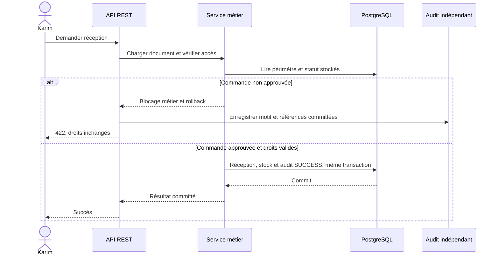

# Scénario [identifiant — titre]

Exemple documentaire à remplir, pas un parcours déjà implémenté.

## Contexte et état initial

- Besoin, acteur, module et phase autorisée : [...]
- Compte/session, rôles, permissions indissociables et attributions datées : [...]
- Document stocké, société/site/centre, auteur, statut : [...]
- Horloge et bornes UTC [début, fin) : [...]

## Diagnostic et remédiation

- Étape du refus parmi les six contrôles : [...]
- Authentification, action/périmètre, SoD/contexte ou condition métier : [...]
- Correction minimale approuvée si droit réellement absent ; **aucune correction de rôle pour un document non prêt**.
- Exemple Karim : RECEIVE/Casablanca + PO DRAFT → blocage métier ; approbation distincte de la PO, sans modification des droits de Karim.
- Expiration d’attribution distincte du compte désactivé et de la session révoquée : [...]

## Séquence à adapter

## Tests et preuves

Adapter [la matrice](../references/scenario-test-matrix.md). Préciser entrées, résultat HTTP/code, état métier après transaction, accès restants, preuve d’audit et contrôles de concurrence pertinents.

## Rejouabilité (si autorisée)

Nouvelle exécution d’exercice sous profil lab et contrôle d’accès explicite ; archivage logique de l’exécution précédente, sans purge d’audit ni suppression de volumes. Décrire les limites ; ne pas créer un endpoint de reset par défaut.
